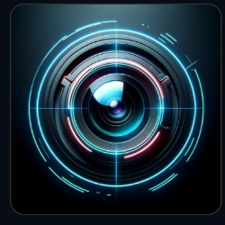

<div align="center">



# NOXIVARA
### **AI IMAGE RESTORATION ENGINE**
*Low-Light Enhancement &middot; Denoising &middot; Colour Restoration*

<p>
  <strong><em>"Bring the Hidden Details to Light."</em></strong>
</p>

[](https://python.org)
[](https://pytorch.org)
[](https://flask.palletsprojects.com)
[](#architecture)
[](LICENSE)

</div>

---

## 📖 Overview

**NOXIVARA** is a degradation-aware AI image restoration system engineered for **joint low-light enhancement, denoising, and colour restoration**. Powered by the custom **DAResUNet** deep residual architecture (Exp11 · 3.92M parameters), Noxivara automatically diagnoses scene illumination physics across 8 distinct categories, applies adaptive ISP tone curves, and continuously learns from user ratings to refine its restoration parameters over time.

---

## 🌟 Key Features

- **🧠 Custom DAResUNet Architecture:** Dual-branch Residual U-Net with CBAM spatial/channel attention and multi-level FiLM degradation conditioning.
- **🎯 8-Category Scene Classifier:** Real-time automatic diagnosis:
  - `WARM_INDOOR_LIT` &mdash; Incandescent tungsten lamps, warm interior walls (prevents nuclear yellow tint).
  - `HDR_LOCAL_LIGHT` &mdash; Extreme dynamic range (desk lamps, bright windows, dark rooms).
  - `NEON_COLORED` &mdash; Ambient RGB / LED lighting, gaming stations (anti-blocking JPEG artifact suppression).
  - `GOLDEN_HOUR` &mdash; Sunsets, dusk, warm outdoor light (preserves natural silhouettes & golden skies).
  - `OVERCAST_OUTDOOR` &mdash; Diffused daylight and cloudy outdoor scenes.
  - `EXTREME_DARK` &mdash; Sub-0.05 lux scenes with deep shadow recovery.
  - `MODERATE_LOWLIT` &mdash; Standard dim interiors and evening photos.
  - `DAYLIGHT` &mdash; Well-exposed natural lighting with gentle detail polish.
- **🎨 LAB-Chroma Adaptive ISP:** Measured via absolute euclidean chroma ($a^*, b^*$). Automatically prevents over-saturation on already-vibrant scenes while lifting deep desaturated shadows.
- **🔄 Continuous Feedback Learning Loop:** Built-in rating system (1&ndash;5 stars + diagnostic notes). Automatically adjusts ISP parameter bounds via keyword sentiment and fine-tunes neural weights.
- **💻 Cyber Dark Web Application:** Sleek glassmorphic web UI with drag-and-drop upload, real-time stage progress, interactive Before/After comparison slider, and past restorations gallery.

---

## 🚀 Quick Start

### 1. Clone the repository

```bash
git clone https://github.com/biswaranjanswain/noxivara.git
cd noxivara
```

### 2. Set up the environment

```bash
python3 -m venv .venv
source .venv/bin/activate       # On macOS/Linux
# .venv\Scripts\activate        # On Windows

pip install -r requirements.txt
```

### 3. Launch the Web Application

```bash
python3 app.py
```

Open your browser and navigate to **`http://localhost:5001`**.

---

## 🖥️ Command-Line Interface (CLI)

Restore images directly from the terminal:

```bash
# Basic single image restoration
python3 restore.py --input path/to/dark_image.jpg --output restored.png

# Restoring with specific gain override
python3 restore.py --input path/to/dark_image.jpg --output restored.png --gain 2.0

# Unified restore and rate session
./quick_restore.sh path/to/dark_image.jpg
```

---

## 🔁 Continuous Learning & Feedback System

Noxivara gets smarter the more you use it:

```bash
# 1. Rate a restored output (1 to 5 stars)
python3 feedback.py --input photo.jpg --output restored.png --rating 2 --note "too yellow on walls"

# 2. View feedback database & statistics
python3 feedback.py --stats
python3 feedback.py --view --bad-only

# 3. Auto-improve ISP parameters based on user feedback
python3 auto_improve.py

# 4. Neural fine-tuning on problematic samples
python3 auto_improve.py --finetune --epochs 5
```

---

## 🏗️ Architecture

```
NOXIVARA Engine
│
├── 1. Diagnostic Scene Analyzer
│   ├── RGB / LAB / HSV statistical breakdown
│   ├── Dynamic luminance histogram profiling (p05, p50, p95, p99)
│   └── 8-Category Scene Classifier Dispatcher
│
├── 2. Neural Feature Recovery (DAResUNet_v2)
│   ├── Tiled Hann-window inference (256x256, 128 stride)
│   ├── Multi-scale residual attention blocks (CBAM)
│   └── 3.92M parameters trained for 50 epochs (val PSNR: 20.67 dB)
│
├── 3. Scene-Aware Post-Processing Pipeline
│   ├── Shadow Noise Roll-off (< 0.02 lux noise floor suppression)
│   ├── Highlight Cosine Preservation (screens, neon, sunset disks)
│   └── Overexposure Guard Gate
│
└── 4. Adaptive ISP & Polish
    ├── LAB absolute chroma expansion
    ├── Edge-preserving bilateral anti-blocking filter
    └── Selective high-SNR unsharp mask
```

---

## 📁 Repository Structure

```
noxivara/
├── app.py                      # Flask web server & REST API
├── restore.py                  # Core Noxivara inference pipeline
├── feedback.py                 # SQLite rating & feedback manager
├── auto_improve.py             # Continuous self-tuning engine
├── quick_restore.sh            # Interactive terminal restore script
├── requirements.txt            # Python dependencies
├── models/
│   ├── da_resunet.py           # Base DAResUNet model
│   ├── da_resunet_v2.py        # Master v2 architecture (Exp11)
│   └── da_resunet_exp10c.py    # Dual-branch color refined model
├── experiments/
│   └── experiment_11_master/
│       └── checkpoints/
│           └── best.pth        # Model weights (see Releases)
├── templates/
│   └── index.html              # Cyber-themed Web UI
├── static/
│   ├── logo.png                # Noxivara brand identity logo
│   └── uploads/                # Temporary processing buffer
└── feedback_db/
    ├── feedback.sqlite         # User rating database
    └── learned_isp_params.json # Self-tuned ISP parameter state
```

---

## ⚙️ REST API Endpoints

| Method | Endpoint | Description |
|:---:|---|---|
| `GET` | `/` | Web application homepage |
| `POST` | `/api/restore` | Multipart image upload; returns `task_id` |
| `GET` | `/api/status/<task_id>` | Poll task status, diagnosis, and image URLs |
| `POST` | `/api/feedback` | Submit 1&ndash;5 star rating and diagnostic notes |
| `GET` | `/api/history` | Retrieve past restoration history cards |
| `GET` | `/api/stats` | Aggregate performance and feedback statistics |
| `POST` | `/api/auto-improve` | Trigger ISP self-improvement routines |
| `GET` | `/uploads/<filename>` | Serve processed images |

---

## 📜 Academic Project Notice

**Project Title:** *Degradation-Aware Latent Diffusion Network for Joint Low-Light Enhancement, Denoising and Colour Restoration*  
**System Name:** **NOXIVARA**  
**Author:** Biswaranjan Swain  
**License:** MIT License  

*"Bring the Hidden Details to Light."*
